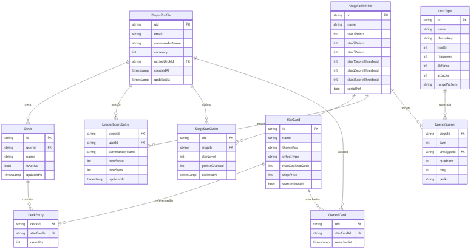
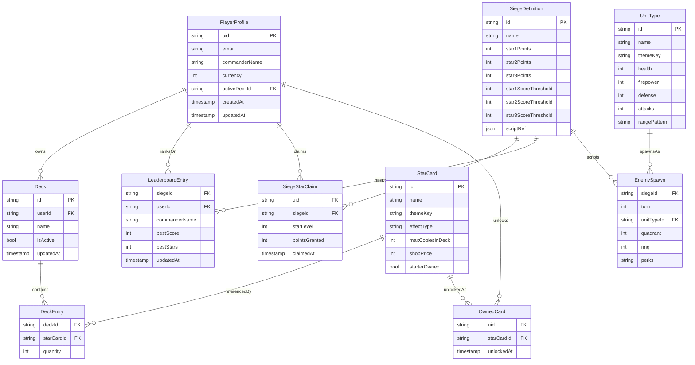

# Data Design / ERD — Base Command Clone

HW8 data design. Expands the starter ERD from the project plan with grilled decisions (shop, first-time star pots, leaderboard, Commander name).

**Hosting shape:** Firebase Auth + Firestore for player data. Static catalogs (cards, units, sieges, bible numbers) ship as **local content** (JSON / bible), not player-editable CRUD.

---

## Entity overview

| Entity | Where it lives | CRUD? |
|--------|----------------|-------|
| **PlayerProfile** | Firestore | Update (currency, unlocks, active deck, claimed stars) |
| **Deck** + **DeckEntry** | Firestore | **Full CRUD** (primary graded entity) |
| **LeaderboardEntry** | Firestore | Upsert on siege complete (best score) |
| **SiegeRunResult** (optional log) | Firestore | Create on finish (history); not required for MVP if leaderboard covers demo |
| **StarCard** (catalog) | Local content | Read-only |
| **UnitType** (catalog) | Local content | Read-only |
| **SiegeDefinition** (script + star pots) | Local content | Read-only |
| **UnitInstance / Battlefield** | In-memory only | Not persisted (no mid-siege save) |

---

## ERD



Source diagram: [`erd.mmd`](erd.mmd).



---

## Relationships (plain language)

- One **PlayerProfile** owns many **Decks** (max 10) and many **OwnedCards**.
- A **Deck** has many **DeckEntries** (starCardId + quantity). Sum of quantities may be &lt; 24 (draft) or exactly 24 (legal for siege).
- **StarCard / UnitType / SiegeDefinition** are content catalogs — referenced by ID, not authored in-app.
- **SiegeStarClaim**: composite uniqueness `(uid, siegeId, starLevel)` — each star pot paid at most once.
- **LeaderboardEntry**: one row per `(siegeId, userId)`; upsert when a finished run beats `bestScore`.
- **EnemySpawn** rows (or equivalent JSON in the siege script) define deterministic enemy placement/behavior.

---

## Firestore collections (suggested)

```text
users/{uid}
  commanderName, email, currency, activeDeckId, createdAt, updatedAt

users/{uid}/ownedCards/{starCardId}
  unlockedAt

users/{uid}/decks/{deckId}
  name, isActive, updatedAt
  entries: [{ starCardId, quantity }, ...]   // embedded array OK for 24-card decks

users/{uid}/starClaims/{siegeId_starN}       // e.g. tutorial_1, tutorial_2, tutorial_3
  siegeId, starLevel, pointsGranted, claimedAt

leaderboards/{siegeId}/entries/{uid}
  commanderName, bestScore, bestStars, updatedAt
```

Auth: Firebase Auth `uid` is the profile PK. Email stays in Auth (+ optional copy on profile); **leaderboards use `commanderName` only**.

---

## Local content (not Firestore CRUD)

Shipped with the app / bible:

- Star Card catalog (effects, `maxCopiesInDeck`, `shopPrice`, `starterOwned`)
- Unit Type catalog (stats, range patterns)
- Siege definitions (enemy script, score thresholds for 1★/2★/3★, point pots per star)
- Balance bible numbers (cannon charge, base HP, etc.)

---

## Invariants (enforce in ProgressionService / client)

1. Deck count per user ≤ 10.
2. Each `DeckEntry.quantity` ≤ that card’s `maxCopiesInDeck`.
3. Deck may only include `starCardId`s the user owns.
4. Start Siege requires `activeDeck` with Σ quantity = 24.
5. At most one `isActive` deck per user (or derive active solely from `activeDeckId`).
6. Shop: `currency >= shopPrice`; unlock writes `OwnedCard`; deduct currency once.
7. Star rewards: grant pot only if no `SiegeStarClaim` for that `(uid, siegeId, starLevel)`.
8. Leaderboard: update only if new score &gt; stored `bestScore` (or equal score with higher stars — pick one rule and keep it).
9. No persistence of in-siege `UnitInstance` / board state.

---

## In-memory during a siege (not in ERD as stored entities)

- Hand (3 unit + 3 star draws)
- Board zones, unit instances + rank
- Base HP / shields / cannon charge
- Running score / multiplier
- Discard / draw piles

Discarded on quit; on finish → ProgressionService applies currency, claims, leaderboard.

---

## CRUD map (for graders)

Primary hosted CRUD entity: **custom Star Card decks**.

| Operation | Deck |
|-----------|------|
| **Create** | New named deck |
| **Read** | List decks / open deck detail |
| **Update** | Rename, change card entries/quantities, set active |
| **Delete** | Delete a deck |

---

## Note vs plan.md

The plan’s original ERD had `User`, `Deck`, `DeckEntry`, `StarCard`, `UnitType`, `Siege`, `SiegeResult`, `Progress`.  
This document **replaces Progress** with explicit `OwnedCard` + `SiegeStarClaim` + currency on profile, and **clarifies** leaderboard vs one-off results. Use **this file** for the HW8 PDF.
