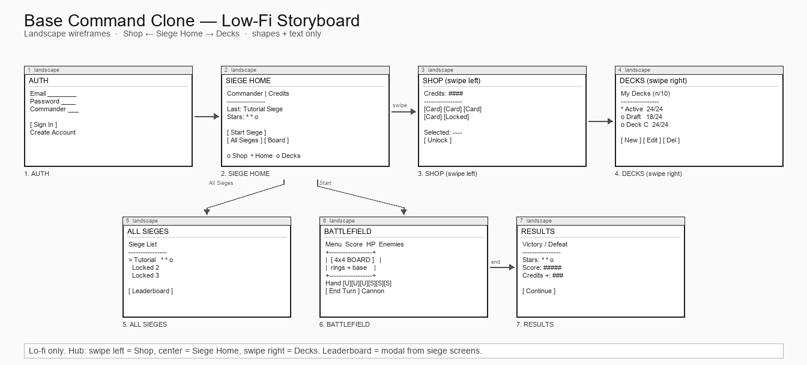

# Storyboard / Visual Mockups (landscape)

## Canonical Figma mockup (use this)

**[`Base Command Visual Mockup.pdf`](Base%20Command%20Visual%20Mockup.pdf)** — geometric landscape UI storyboard from Figma.

Preview export: `figma_mockup_preview/page_1.png`

Screens in the Figma board:
1. Access / Auth  
2. Home (Siege Home)  
3. Shop (swipe left)  
4. Decks (swipe right)  
5. All Sieges (+ leaderboard)  
6. Battlefield  
7. Results (on board)

---

## Older lo-fi collage (superseded by Figma PDF)



```text
[1 Auth] → [2 Siege Home] ↔ swipe → [3 Shop]
                 ↕                 ↔ swipe → [4 Decks]
          [5 All Sieges]
                 │
          [6 Battlefield] → [7 Results]
```

Hub after login: **Siege Home**. Swipe left = Shop. Swipe right = Decs. All screens **landscape**.

---

## 1 — Auth (landscape)

```text
┌──────────────────────────────────────────────┐
│ landscape                                    │
│                                              │
│              AUTH                            │
│                                              │
│         Email     [ ______________ ]         │
│         Password  [ ______________ ]         │
│         Commander [ ______________ ]         │
│                                              │
│              [  Sign In  ]                   │
│              Create Account                  │
└──────────────────────────────────────────────┘
```

## 2 — Siege Home (hub center)

```text
┌──────────────────────────────────────────────┐
│ landscape     Commander ____    Credits #### │
│                                              │
│         LAST SIEGE: Tutorial                 │
│         Stars: ★ ★ ☆                         │
│                                              │
│         [      Start Siege      ]            │
│         [ All Sieges ]  [ Leaderboard ]      │
│                                              │
│         Active deck: ______  24/24           │
│                                              │
│         ○ Shop    ● Home    ○ Decks          │
└──────────────────────────────────────────────┘
```

## 3 — Shop (swipe left from home)

```text
┌──────────────────────────────────────────────┐
│ landscape              SHOP     Credits #### │
│                                              │
│   ┌─────┐ ┌─────┐ ┌─────┐ ┌─────┐           │
│   │Card │ │Card │ │Lock │ │Lock │           │
│   │     │ │     │ │ ### │ │ ### │           │
│   └─────┘ └─────┘ └─────┘ └─────┘           │
│                                              │
│   Selected: ________                         │
│   [ Unlock ]                                 │
│                                              │
│         ● Shop    ○ Home    ○ Decks          │
└──────────────────────────────────────────────┘
```

## 4 — Decks (swipe right from home)

```text
┌──────────────────────────────────────────────┐
│ landscape           MY DECKS (n/10)          │
│                                              │
│   ● Starter Defense     24/24   ACTIVE       │
│   ○ Heavy Assault       18/24   draft        │
│   ○ Hero Focus          24/24                │
│                                              │
│   [ New Deck ]  [ Edit ]  [ Delete ]         │
│                                              │
│         ○ Shop    ○ Home    ● Decks          │
└──────────────────────────────────────────────┘
```

## 5 — All Sieges (+ Leaderboard modal)

```text
┌──────────────────────────────────────────────┐
│ landscape           ALL SIEGES               │
│                                              │
│   ▶ Tutorial Siege      ★ ★ ☆                │
│     Siege 2             🔒                   │
│     Siege 3             🔒                   │
│                                              │
│   [ Leaderboard ]                            │
│                                              │
│   ┌─ modal (optional) ─────────────────┐     │
│   │ LEADERBOARD — Tutorial             │     │
│   │ 1. Commander A    score    ★★★     │     │
│   │ 2. Commander B    score    ★★☆     │     │
│   │ 3. You            score    ★★☆     │     │
│   │            [ Close ]               │     │
│   └────────────────────────────────────┘     │
└──────────────────────────────────────────────┘
```

## 6 — Battlefield

```text
┌──────────────────────────────────────────────┐
│ Menu   Score/Stars   Base HP   Enemies Left  │
│                                              │
│  [U]     ┌─────────────────────┐      [S]   │
│  [U]     │                     │      [S]   │
│  [U]     │   4×4 BOARD         │      [S]   │
│          │   rings + base      │            │
│          │   (schematic)       │            │
│          └─────────────────────┘            │
│                                              │
│         [ End Turn ]      Cannon □□□░        │
└──────────────────────────────────────────────┘
```

## 7 — Results

```text
┌──────────────────────────────────────────────┐
│ landscape                                    │
│                                              │
│              RESULTS                         │
│           Victory / Defeat                   │
│                                              │
│              Stars: ★ ★ ☆                    │
│              Score: #####                    │
│              Credits +: ###                  │
│                                              │
│              [ Continue ]                    │
└──────────────────────────────────────────────┘
```

---

## Figma prompt (~1700 chars)

Also in [`figma_prompt.txt`](figma_prompt.txt):

```text
Design a polished geometric UI storyboard for a landscape-only iPhone game (always 16:9 sideways).

Style: clean modern iOS game chrome — pleasant, intentional. Use only basic geometry: rounded cards, circles, rings, bars, stars, dots, short labels. Flat/soft-flat; palette off-white, light gray, charcoal text, one accent (muted gold or soft blue). Consistent radius, spacing, SF/Inter-like type. Optional thin landscape iPhone outlines (empty bezels). Forbidden: characters, ships, faces, logos, Star Wars art, 3D miniatures, photo textures, neon glow, cluttered gradients, photoreal/AI cinematic art, ugly raw wireframes.

Screens (all landscape):
1. Auth — card: email, password, commander name; Sign In; Create Account
2. Siege Home (post-login default) — commander + credits; last-siege card with title + 3 stars; Start Siege; All Sieges; Leaderboard; active deck 24/24 chip; pager dots Shop|Home|Decks
3. Shop (swipe left) — credits; card grid (owned solid / locked dashed + price); Unlock; Shop dot selected
4. Decks (swipe right) — deck rows (name, 24/24 or draft, Active pill); New/Edit/Delete; Decks dot selected
5. All Sieges — level rows (1 unlocked + stars, others locked); Leaderboard modal: name, score, stars, Close
6. Battlefield — HUD (menu, score/stars, HP bar, enemies); center concentric 4-ring board + quadrant lines + base circle; 3 unit + 3 star card slots; End Turn; cannon segments
7. Results — Victory/Defeat card, 3 stars, score, credits pill, Continue

Artboard: title "Base Command Clone — Geometric Landscape UI". Arrows: Auth→Home; Home↔Shop (swipe left); Home↔Decks (swipe right); Home→All Sieges; Home→Battlefield→Results. Reuse one component system across screens.
```
