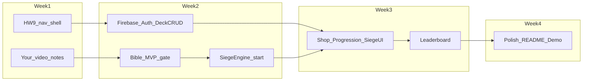

# Base Command — 27-day roadmap (grilled)

Living schedule from HW9 through Project 2. Product locks stay in [`project_rules.md`](project_rules.md); this file is **when** and **who**.

**Anchors:** ~Nov 12 start · HW9 ≈ Nov 19 · Presentations/due ≈ Dec 8–9 (~27 days)  
**Dec 8 demo bar:** Auth + Commander name · live Firebase **deck CRUD** · shop unlock + currency · **one** playable scripted siege · per-siege leaderboard  
**Aspiration:** video-accurate bible first (expect ≫12 cards from footage); class still ships a complete subset, not a half-finished museum

---

## Settled decisions (grill)

| # | Decision |
|---|----------|
| 1 | Dec 8 = course bar above; research informs accuracy, doesn’t expand graded scope |
| 2 | ~8–10h/week from you (research-heavy early) |
| 3 | HW9 = mockup-based navigable shell; iPhone + iPad; your design later / optional for grade |
| 4 | Parallel tracks, not serial research→design→backend→game |
| 5 | **Bible MVP gate** by end of week 2, then hard-start engine (more observed cards = better, not a reason to slip the gate) |
| 6 | You write semi-structured session notes → agent ingests into [`bible/`](bible/) + [`research/video-log.md`](research/video-log.md) |
| 7 | Firebase/CRUD starts week 2 (after HW9), parallel with research wrap-up |
| 8 | New visual design best-effort after HW9; mockup OK through Dec 8 if needed |
| 9 | Ownership split per week table below |

---

## What is required from you (human)

1. **Video research** — watch Base Command footage; capture notes in [`research/notes/`](research/notes/)  
2. **Say “ingest”** when a note batch is ready so bible tables get updated  
3. **Decide invented gaps** when video never shows a number (mark `invented`)  
4. **Optional:** Figma → [`design/current/`](design/current/) after HW9  
5. **Week 4:** demo script + walkthrough of CRUD/siege/leaderboard; README secrets are placeholders only  
6. **Firebase console** — create project / enable Auth+Firestore / download `GoogleService-Info.plist` (agent can guide; you own the account)

Agent/pair owns: HW9 shell + dual-size layout, Firebase wiring, deck CRUD UI, `SiegeEngine`/`ProgressionService` + tests, shop/leaderboard, polish, README/run docs.

---

## Research capture

- Session notes: [`research/notes/`](research/notes/) (see `TEMPLATE.md`)  
- Ingest rule: raw notes stay; promotions land in [`bible/star-cards.md`](bible/star-cards.md), [`units.md`](bible/units.md), [`sieges.md`](bible/sieges.md), [`GAME_BIBLE.md`](bible/GAME_BIBLE.md) with confidence + Log IDs in [`research/video-log.md`](research/video-log.md)

**Bible MVP gate** (end of week 2 — start engine even if catalog is larger):

- Core loop rules mostly `observed` (gaps `invented`)
- ≥12 Star Cards with effects + `maxCopies` (**keep going past 12** as you find them)
- 4 player unit types with ranges + stats
- 1 siege spawn script + star thresholds (invent thresholds if UI never shows them)

---

## Week-by-week

### Week 1 (now → ~Nov 19) — Research + HW9

**You:** Dedicated video sessions → `research/notes/`; aim for a fat first ingest (cards/units/cannon/board).  
**Pair:** Extend [`SwiftCode/`](SwiftCode/) so **all main areas** navigate (Access, Shop/Home/Decks, All Sieges, Battlefield, Results, Leaderboard); **iPhone + iPad** layouts; ZIP + PDF/Loom for HW9. Stay on mockup visual language.

**Exit:** HW9 submitted · note corpus growing · no Firebase required yet

### Week 2 (~Nov 19–26) — Bible gate + hosting + engine start

**You:** Finish MVP gate notes; ingest passes; Firebase project + plist.  
**Pair:** Auth + Commander name · Firestore deck **CRUD** live from simulator · compile bible subset → content JSON · `SiegeEngine` + `ProgressionService` **tests first** (per [`PROJECT_SPEC.md`](PROJECT_SPEC.md) seams).

**Exit:** Live deck CRUD · bible gate met · engine under test (playable siege may still be thin)

### Week 3 (~Nov 26–Dec 3) — Playable loop

**You:** Playtest; approve invented fill; optional design restyle kickoff.  
**Pair:** Wire battlefield UI to engine · shop unlocks + first-time star pots · results → leaderboard upsert · one full happy path.

**Exit:** Dec 8 demo path works end-to-end on device/simulator against **live** Firebase

### Week 4 (~Dec 3–8) — Demo harden

**You:** Demo script; confirm demo account in README.  
**Pair:** Bugfix, empty/error states, README (run locally, Firebase placeholders, demo login), presentation dry-run. Stretch only if green: more sieges/cards, design restyle.

**Exit:** Presentation-ready · no secrets in git

---

## Risk order (what slips last)

1. **Never slip:** live deck CRUD + hosting story  
2. **Protect:** one complete siege loop + leaderboard  
3. **Flexible:** full observed card museum, custom Figma restyle, extra sieges  

If research is richer than expected: **ingest everything**, but still flip the week-2 engine switch—extra cards can land as content updates in weeks 3–4.

---

## Near-term slice (Week 1)

1. `research/notes/TEMPLATE.md` + folder  
2. HW9 navigation/completeness + iPhone/iPad pass on existing mockup shell  
3. You research; next ingest into bible when you ask  

No Firebase or SiegeEngine in that first slice.
