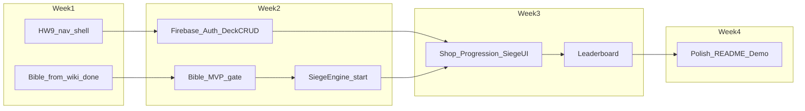

# Base Command — 27-day roadmap (grilled)

Living schedule from HW9 through Project 2. Product locks stay in [`project_rules.md`](project_rules.md); this file is **when** and **who**.

**Anchors:** ~Nov 12 start · HW9 ≈ Nov 19 · Presentations/due ≈ Dec 8–9 (~27 days)  
**Dec 8 demo bar:** Auth + Commander name · live Firebase **deck CRUD** · shop unlock + currency · **one** playable scripted siege · per-siege leaderboard  
**Research:** Wiki → bible catalogs are largely `observed`. Remaining TBD (siege scripts, score thresholds, credit pots, shop prices) = optional video confirmation or `invented` in bible.

---

## Settled decisions (grill)

| # | Decision |
|---|----------|
| 1 | Dec 8 = course bar above; research informs accuracy, doesn’t expand graded scope |
| 2 | ~8–10h/week from you (research-heavy early — **wiki capture done**) |
| 3 | HW9 = mockup-based navigable shell; iPhone + iPad; your design later / optional for grade |
| 4 | Parallel tracks, not serial research→design→backend→game |
| 5 | **Bible MVP gate** by end of week 2, then hard-start engine |
| 6 | Optional video confirmations → [`bible/`](bible/) + [`research/video-log.md`](research/video-log.md); no `research/notes/` folder |
| 7 | Firebase/CRUD starts week 2 (after HW9) |
| 8 | New visual design best-effort after HW9; mockup OK through Dec 8 if needed |
| 9 | Ownership split per week table below |

---

## What is required from you (human)

1. **Optional TBD fill** — confirm siege scripts / thresholds / shop prices on video when needed; say “ingest” to promote into bible + video-log  
2. **Decide invented gaps** when video never shows a number (mark `invented` in bible)  
3. **Optional:** Figma → [`design/current/`](design/current/) after HW9  
4. **Week 4:** demo script + walkthrough of CRUD/siege/leaderboard; README secrets are placeholders only  
5. **Firebase console** — create project / enable Auth+Firestore / download `GoogleService-Info.plist` (agent can guide; you own the account)

Agent/pair owns: HW9 shell + dual-size layout, Firebase wiring, deck CRUD UI, `SiegeEngine`/`ProgressionService` + tests, shop/leaderboard, polish, README/run docs.

---

## Research status

- **Done:** Namu wiki extracts in [`research/wiki/`](research/wiki/) promoted into [`bible/`](bible/)  
- **Provenance only:** raw dump [`research/base command research/`](research/base%20command%20research/); superseded ChatGPT dump in [`research/archive/`](research/archive/)  
- **Optional:** [`research/video-log.md`](research/video-log.md) for footage confirmation of remaining TBD  
- **Ingest rule:** promotions land in bible files with confidence tags (+ Log IDs in video-log when from footage)

**Bible MVP gate** (end of week 2 — start engine):

- Core loop rules mostly `observed` (**met** from wiki)  
- ≥12 Star Cards with effects + `maxCopies` (**met**; keep growing if footage adds clarity)  
- 4 player unit types with ranges + stats (**met**)  
- **Still open:** 1 siege spawn script + star thresholds + pots (invent thresholds/pots if UI never shows them); shop prices TBD

---

## Week-by-week

### Week 1 (now → ~Nov 19) — HW9 (+ optional TBD)

**You:** Optional video only for siege/shop TBD; invent elsewhere in bible when needed.  
**Pair:** Scaffold Flutter in [`app/`](app/) with navigable main areas (Access, Shop/Home/Decks, All Sieges, Battlefield, Results, Leaderboard); iPhone-sized layout first. If Flutter isn’t ready by Wed night, submit HW9 from [`course/archive/SwiftCode/`](course/archive/SwiftCode/).

**Exit:** HW9 submitted · bible already usable · no Firebase required yet

### Week 2 (~Nov 19–26) — Bible gate + hosting + engine start

**You:** Invent/confirm remaining gate TBD (script + thresholds/pots); Firebase project + plist.  
**Pair:** Auth + Commander name · Firestore deck **CRUD** live from simulator · compile bible subset → content JSON · `SiegeEngine` + `ProgressionService` **tests first** (per [`PROJECT_SPEC.md`](PROJECT_SPEC.md) seams).

**Exit:** Live deck CRUD · bible gate met · engine under test (playable siege may still be thin)

### Week 3 (~Nov 26–Dec 3) — Playable loop

**You:** Playtest; approve invented fill; optional design restyle kickoff.  
**Pair:** Wire battlefield UI to engine · shop unlocks + first-time star pots · results → leaderboard upsert · one full happy path.

**Exit:** Dec 8 demo path works end-to-end on device/simulator against **live** Firebase

### Week 4 (~Dec 3–8) — Demo harden

**You:** Demo script; confirm demo account in README.  
**Pair:** Bugfix, empty/error states, README (run locally, Firebase placeholders, demo login), presentation dry-run. Stretch only if green: more sieges/cards, design restyle.

**Exit:** Presentation-ready · no secrets in git

---

## Risk order (what slips last)

1. **Never slip:** live deck CRUD + hosting story  
2. **Protect:** one complete siege loop + leaderboard  
3. **Flexible:** full observed card museum, custom Figma restyle, extra sieges  

Extra cards can land as content updates in weeks 3–4 — still flip the week-2 engine switch.

---

## Near-term slice (Week 1)

1. HW9 navigation/completeness + iPhone/iPad pass on existing mockup shell  
2. Optional: invent/confirm `siege_01` script + thresholds/pots in [`bible/sieges.md`](bible/sieges.md)  
3. No Firebase or SiegeEngine in that first slice
